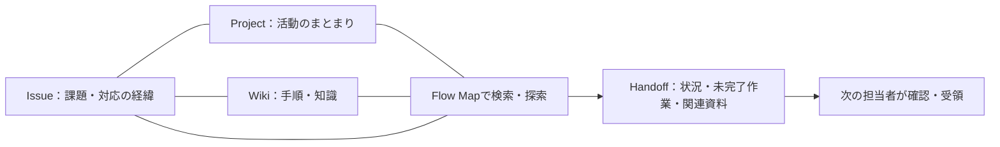

# IntelliFlow

## 情報をつなぎ、次の人へ。

課題、プロジェクト、知識、引き継ぎ情報をひとつにつなぐWebアプリケーションです。
「何をするか」だけでなく、「なぜそうなったか」「次の担当者が何を知るべきか」までたどれることを目指しています。

**公開URL：<https://intelli-flow-pi.vercel.app>**

個人開発の就職活動用ポートフォリオです。UIだけでなく、認証・認可、データの整合性、AIの利用制御、既存データを保護する移行とテストまでを開発対象にしています。

> 公開サイトとリポジトリの最新コードは、デプロイ時期によって表示が異なる場合があります。LP・ログイン・新規登録画面のリニューアルはローカルで検証済みです。最新UIの確認方法は[こちら](docs/lp-auth-renewal.md)を参照してください。

## 開発の背景

資料やタスクを保存しても、その背景や関連資料まで共有できていなければ、担当者が変わるたびに情報を探し直すことになります。

- 前任者しか作業の経緯を知らない。
- 過去に似た問題が起きていても、資料が見つからない。
- 引き継ぎ資料を読んでも、未完了の作業や次の行動が分からない。

IntelliFlowでは、情報を**関連付けて探すFlow Map**と、必要な背景を**確認して渡すHandoff**を組み合わせ、この断絶を減らす設計にしました。会社だけでなく、学校・サークル・個人の活動でも使えるよう、日本語の説明とシンプルな操作を重視しています。

## まず見てほしい体験

イベント運営を例にすると、次の流れで利用できます。

1. **Issue（課題）**に「イベント準備の進捗が分からない」を登録する。
2. **Wiki**の「イベント運営マニュアル」と、対象の**Project**を関連付ける。
3. **Flow Map**で検索し、課題・資料・プロジェクトのつながりから経緯を確認する。
4. **Handoff**に現在の状況、残った作業、注意事項、関連資料をまとめる。
5. 次の担当者が内容を確認して受領し、引き継いだ版と日時を記録する。



最新LPには、この流れを**ログインせずに試せる5段階のミニデモ**を用意しています。Heroのグラフもノードをクリックして操作できます。どちらも架空の固定データを使い、SupabaseやGemini APIには接続しません。

## 主な機能

| 機能 | できること |
| --- | --- |
| 認証・ワークスペース | メール・パスワード／Google／メールリンク認証、ワークスペース作成・切り替え、招待、Owner・Admin・Member・Viewerの権限管理 |
| Issues | 課題の作成・編集・アーカイブ、ワークスペース内の一意な番号、担当者・期限・優先度・状態・ラベル、コメント、関連課題、検索・絞り込み・更新履歴 |
| Projects | メンバー・日程・関連課題の管理、実際の課題から計算した進捗、一覧・カンバン表示 |
| Wiki | リッチテキスト編集、画像添付、ページ階層・カテゴリ・検索、過去バージョン、Issue・Projectとの相互参照 |
| Flow Map | タイトル・本文の検索、種類・更新日・Projectの絞り込み、関連ノードの段階的な取得、詳細表示、元ページへの移動 |
| Handoff | Issue・Projectから候補を取得、下書き・送信・受領・完了、送信時のスナップショット、版ごとの受領履歴、改訂後の再確認 |
| AI支援 | 登録情報に基づく根拠付きチャット、Flow MapのAI質問、確認して反映するHandoff下書き |
| 共通UI | レスポンシブなナビゲーション、アプリ内のライト／ダークモード、ローディング・エラー・空状態 |

Handoffの「送信」はアプリ内での共有と状態更新です。メール通知の機能ではありません。AIを無効にしても、通常の課題管理・検索・引き継ぎは利用できます。

## 設計と実装の見どころ

### 1. グラフを「過去の情報を探す道具」にする

Flow Mapは装飾的な全件グラフではなく、検索結果と直接関連する情報から探索を始めます。関連情報は必要に応じて追加取得し、初期表示と通信量を制限します。

課題・資料をグラフ用に複製せず、既存レコードのIDと関連付けを利用します。日本語の検索にはPostgreSQLの部分一致とtrigramインデックスを使い、別のグラフDBやベクトルDBを追加せずに構成しました。

実装：[Flow Map UI](features/flow/components/FlowExplorer.tsx)／[描画](features/flow/components/FlowCanvas.tsx)／[検索・関連取得](lib/flow.ts)

### 2. 「最新の情報」と「引き継いだ時点」を分ける

元のIssueやWikiが更新されても、何を渡し、どの内容に対して受領したかを確認できるようにしています。

- 送信時にDB側で関連資料を取得し、内容のスナップショットを作成。
- 元ページへのリンクと送信当時の記録を分けて表示。
- 受領者・日時・内容の版を保存し、重要な変更は新しい版として再確認を依頼。
- 受領・完了は指定された受取人だけが実行可能。

実装：[Handoff UI](features/handoffs/components/HandoffUI.tsx)／[データアクセス](lib/handoffs.ts)／[バージョン・受領のDB定義](supabase/migrations/20261017113749_phase6_handoff.sql)

### 3. 画面・API・DBで権限を守る

サーバーで本人確認とワークスペースの所属・役割を検証し、PostgreSQLのRLSでもアクセス境界を守ります。通常のユーザー操作にService Role Keyを使用しません。

関連先・担当者・グラフの両端が同一ワークスペースであることもDBで検証します。Wikiは許可した文書構造を検証して表示し、画像は非公開Storageと権限確認を通して取得します。

実装：[認証・認可](lib/auth/server.ts)／[安全な遷移先の検証](lib/auth/policy.ts)／[Wiki文書の検証・表示](features/wiki/document.ts)／[マイグレーション](supabase/migrations)

### 4. AIを、根拠を確認できる補助機能にする

AIは明示的な操作時だけ呼び出します。通常の画面表示・保存・検索では呼び出しません。

```text
質問 → 本人・所属・AI設定・同意の確認
     → PostgreSQLで検索 → 閲覧可能な少数の資料へ絞り込み
     → DBで利用回数を予約 → サーバーからGeminiへ送信
     → 構造化出力・根拠ID・権限の再検証 → 回答と元ページへのリンク
```

- 資料は最大8件、各本文は最大1,200文字、資料コンテキストは最大12,000文字に制限。
- 根拠リンクはAIが返したURLを使わず、検証したレコードIDからアプリが生成。
- 資料中の命令をシステム指示として扱わず、出力は実行時のスキーマ検証を実施。
- Handoff下書きはプレビュー後に人が反映・保存。AIによる受領や課題の完了処理は行わない。
- 初期上限はユーザー1日10回・ワークスペース1日50回。DBのトランザクションとロックで同時要求を制御。
- APIキー・質問全文・資料本文・生成本文を利用ログに保存せず、権限の異なるユーザー間で回答を共有キャッシュしない。

AIはワークスペース・利用者とも初期無効です。利用者が外部送信を判断できるよう、有効化と送信同意を設けています。アプリの回数上限はGoogle側の利用制限とは別で、無料利用や応答の正確性を保証するものではありません。

実装：[AI API](app/api/gemini/route.ts)／[RAG・データ取得](lib/ai.ts)／[出力検証](features/ai/validation.ts)／[モデル・上限の一元管理](features/ai/config.ts)

### 5. 操作を通して価値が伝わるフロントエンド

LPはノード選択による関連表示、Before/After比較、機能タブ、段階的な体験デモをReactの状態で制御します。Motion・CSS・SVGを使い分け、マウス連動にはMotionValueを使用して、毎フレームのReact再レンダリングを避けています。

スクロール出現、接続線の光、フォームのフォーカス表示に加え、キーボード操作・モバイル表示・`prefers-reduced-motion`に対応。デモと実データを明確に区別し、認証画面は既存のcallbackを維持した共通レイアウトにしています。

実装：[LP](app/components/marketing/Landing.tsx)／[インタラクティブグラフ](app/components/marketing/FlowGraph.tsx)／[認証UI](app/components/SupabaseAuth.tsx)

## 技術スタック

| 領域 | 採用技術 | 採用理由・用途 |
| --- | --- | --- |
| アプリ基盤 | Next.js App Router・React・TypeScript | サーバーでの認証・データ取得と、操作に応じるクライアントUIを分離 |
| UI | CSS・Motion・SVG | 既存UIと統一しながら、レスポンシブ表示と軽量なインタラクションを実装 |
| グラフ | React Flow（`@xyflow/react`） | 業務画面のノード選択・移動・ズーム・関連探索 |
| エディタ | Tiptap | Markdownを知らなくても使えるWiki編集 |
| 認証・DB・画像 | Supabase Auth・PostgreSQL・Storage | セッション、RLS、関連制約、トランザクション、添付の権限制御 |
| AI | Gemini API（サーバー側REST） | 検索結果に基づく回答と構造化された下書き。既存のfetch実装を再利用 |
| テスト | Node.js Test Runner・PGlite・実PostgreSQL・Playwright | ドメイン処理・SQL・権限・HTTP・ブラウザを段階的に検証 |
| 公開 | Vercel | 既存プロジェクトとGit連携を利用 |

依存関係・実行コマンドの正本は[package.json](package.json)です。

## 構成

```text
app/
  page.tsx                  # LP
  login/・signup/           # 認証画面
  app/w/[workspaceId]/      # ワークスペース内の各画面
  api/                      # 本人確認・入力検証を行うAPI Routes
  components/marketing/     # LP・認証のブランドUI
components/                 # アプリシェル・共通UI
features/                   # 機能別のUI・型・入力検証・スタイル
lib/                        # 認証・Supabase・機能別データアクセス
supabase/migrations/        # バージョン管理した7本の追加マイグレーション
tests/                      # 単体・DB・HTTP・ブラウザ検証、隔離fixture
docs/                       # 設計・実装・検証・公開手順
```

## ローカル起動

Node.js 22.15以降とnpm、マイグレーション適用済みの**開発用Supabase**を用意してください。

```bash
git clone https://github.com/Shunnsuke-cloud/IntelliFlow.git
cd IntelliFlow
npm ci
```

`.env.local`に以下の項目を設定します。既存ファイルがある場合は上書きせず、設定済みの値を維持してください。

| 環境変数 | 用途 |
| --- | --- |
| `NEXT_PUBLIC_SUPABASE_URL` | 開発用SupabaseのURL |
| `NEXT_PUBLIC_SUPABASE_ANON_KEY` | 公開可能なanon／publishableキー |
| `GEMINI_API_KEY` | AI利用時のみ必要なサーバー用キー |
| `GEMINI_MODEL` | 現在の実装で検証対象としているモデルID：`gemini-3.8-flash` |
| `SUPABASE_URL`・`SUPABASE_ANON_KEY` | 任意。サーバー側の接続設定。未指定なら上記の公開用設定を利用 |

ブラウザとサーバーのSupabase接続先は同じ開発プロジェクトに揃えます。Service Role Keyは通常機能に不要です。AIのキーが未設定でも、AI以外の基本機能は利用できます。

Supabase Authには開発URLと`http://localhost:3000/auth/callback`を許可し、Google認証を使う場合はProvider設定も用意します。DBは既存のテーブル・履歴を確認してからマイグレーションを適用してください。旧`supabase-migrations/`や管理用スクリプトを、通常の起動手順として実行する必要はありません。

```bash
npm run dev
# http://localhost:3000
```

実サービスを使わずに認証UIや主要機能を試す場合は、[隔離したローカル環境の手順](docs/lp-auth-renewal.md)を使用できます。

## 品質確認とテスト

```bash
npm run lint
npm run typecheck
npm test
npm run build
```

直近のLP・認証UIリニューアル時には、上記4項目と**95件のテスト**が成功しました。以下はその実装変更時の検証範囲です。

| 検証層 | 主な確認内容 |
| --- | --- |
| 単体・DBテスト | 入力検証、CRUD、更新競合、履歴、各役割の権限、別ワークスペースへのアクセス拒否、AI出力・利用制限 |
| HTTP統合 | 実際のNext.js APIに対する認証・認可・エラー応答。AuthとGoogle応答は隔離fixtureを使用 |
| 実PostgreSQL | マイグレーション、RLS、別接続からの同時予約、架空データのdump／restore。WindowsのローカルPostgreSQLを使う別実行の検証 |
| アプリのブラウザE2E | ログイン・ログアウト、ワークスペース作成、主要7画面、テーマ・モバイル、Flow検索、AI支援、Handoff保存 |
| LP・認証UIのブラウザ検証 | ノード・タブのキーボード操作、5段階デモ、CTA、登録・エラー・送信中表示、320〜1440pxの5段階でのノード重なり確認、reduced-motion |

`npm test`は本番DB・実ユーザー・外部AIに接続しません。ブラウザテストと実PostgreSQL検証は別途実行する構成です。Playwrightは一時的な実行ツールとして使い、アプリの依存関係には追加していません。

Google認証の開始リクエストとメールリンクのパラメータは検証していますが、直近のUI検証で**実Google認証の完了・実メール配信・スマートフォン実機**まで確認したものではありません。

## 現時点の制約と改善余地

- AI検索はキーワード・部分一致を基礎とし、意味検索ではありません。長文の省略部分や全履歴まで網羅した回答は行いません。
- Handoffの関連資料スナップショットは本文抜粋で、添付ファイルの完全な複製ではありません。
- AIの会話表示はパネル内のメモリに保持し、永続的なチャット履歴は保存しません。
- ブラウザE2EにはWindowsのChromeパスなど環境依存の設定があり、別環境では調整が必要です。

## 設計・検証資料

- [初期調査](docs/renewal/01-investigation.md)／[設計](docs/renewal/02-design.md)／[開発工程](docs/renewal/03-roadmap.md)：開発の出発点と判断の背景。
- [Handoffの仕様](docs/phase6.md)／[AI・RAG・利用回数制御](docs/phase7.md)：権限・データ構造・検証方法の詳細。
- [公開前検証](docs/phase8.md)／[公開・復旧手順](docs/production-launch.md)：当時の監査と作業計画。記載された未適用・未公開の判定は作成時点の履歴であり、現在の本番状態を示すものではありません。
- [LP・認証UIと隔離テスト](docs/lp-auth-renewal.md)：最新UIの実装範囲と再現方法。
- [AGENTS.md](AGENTS.md)：既存データ・秘密情報・権限を守る共通開発ルール。

本番DBの変更、Auth設定、Productionへのデプロイは、対象と影響を確認したうえで個別に承認して進める運用です。READMEの起動手順で本番DBをリセットしたり、テストデータを投入したりしないでください。
