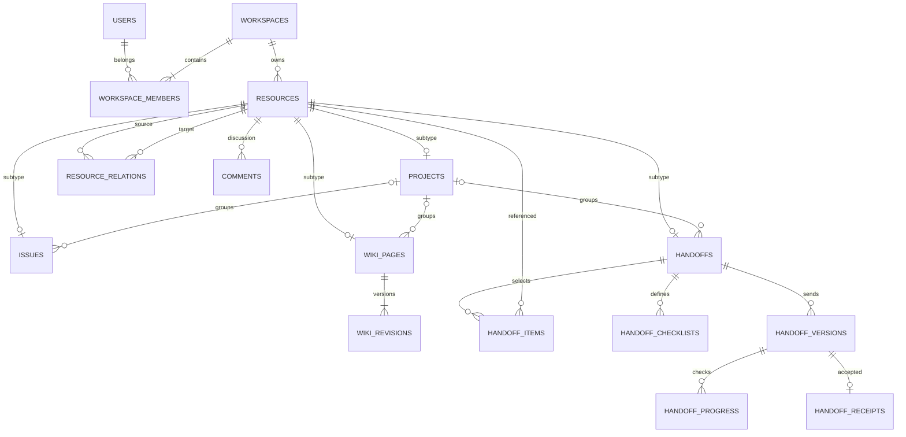

# リニューアル設計案

IntelliFlow — 情報をつなぎ、次の人へ。

本資料は実装前の設計であり、SQL・アプリへの適用はしていない。初期版はワークスペース内で情報を共有し、個別プロジェクトの非公開権限は後続拡張とする。個人利用は1人のワークスペースとして同じ仕組みで扱う。

## 1. 利用の中心となる流れ

1. 課題を登録し、担当者・期限・プロジェクトを指定する。
2. 手順・決定理由をWikiに記録し、課題から「参考資料」としてリンクする。
3. Flow Mapで過去の関連課題・資料を探し、引き継ぎへ追加する。
4. 引き継ぎに現状、次の作業、注意点、確認項目を記入して相手へ渡す。
5. 相手が資料を読み、確認項目を完了して受領する。履歴は次回の引き継ぎから参照できる。

すべて手入力・通常検索で利用できる。AIは検索語の補助、要約案、関連候補、引き継ぎ文章案のみに使い、自動確定しない。

## 2. 画面構成とURL

内部名はIssues等を使いつつ、UIは「課題」「プロジェクト」「資料・手順」「関連マップ」「引き継ぎ」と日本語併記する。

| URL | 内容・主要操作 |
| --- | --- |
| `/` | 新コンセプト、利用例、ログイン導線。実データへ接続しないデモ |
| `/login`, `/auth/callback` | 既存認証方式、確認待ち、callback、エラー |
| `/app` | 所属WS一覧・選択、初回のWS作成 |
| `/app/w/[workspaceId]` | 自分の課題、期限間近、受け取った引き継ぎ、最近の資料 |
| `.../issues`, `.../issues/[id]` | 一覧/状態別表示、作成、担当・期限・状態・コメント・関連情報 |
| `.../projects`, `.../projects/[id]` | 概要、所属課題・資料・引き継ぎ、進捗、アーカイブ |
| `.../wiki`, `.../wiki/[id]` | タイトル/本文検索、下書き、編集、版履歴、関連課題 |
| `.../flow` | 通常検索結果と関連マップ、期間/種別/プロジェクト絞込み、関連理由、引き継ぎへ追加 |
| `.../handoffs`, `.../handoffs/[id]` | 自分が送る/受け取る、下書き、確認項目、送信、受領、版・変更履歴 |
| `.../settings/members` | 招待、役割、脱退、所有者移譲 |
| `.../settings` | WS名称、アーカイブ、AI利用設定 |

`...`は`/app/w/[workspaceId]`。横断検索はFlow画面の一覧タブを入口にし、グラフを読めなくても目的の情報に到達できる。AIアシスタントは各画面から開く任意の補助パネルとする。

共通枠はWS切替、主要ナビ、検索、作成ボタン、ユーザーメニュー。スマートフォンは一覧を先に表示する。フォームはタイトルと本文で開始でき、詳細設定は任意。保存中/保存済み/失敗、権限不足、空状態を明示し、削除よりアーカイブを基本にする。グラフにはキーボードで操作できる関連一覧を併設する。

旧`/app/notes`は移行中の旧ノート閲覧として維持する。旧tasks/flow/searchはWSを選んだ後に対応画面へ誘導し、複数所属時に勝手にWSを決めない。所有者不明の旧ノートは公開せず管理者確認待ちにする。

## 3. 推奨ディレクトリ構成

```text
app/
  page.tsx / layout.tsx
  (auth)/login/page.tsx
  auth/callback/route.ts
  app/
    page.tsx
    notes/page.tsx                   # 移行中の互換画面
    w/[workspaceId]/
      layout.tsx / page.tsx
      issues/[id]/page.tsx
      projects/[id]/page.tsx
      wiki/[id]/page.tsx
      flow/page.tsx
      handoffs/[id]/page.tsx
      settings/members/page.tsx
  api/
    notes/route.ts                   # 保護した互換API
    gemini/route.ts                  # 保護した互換入口
    workspaces/[workspaceId]/
      issues/..., projects/..., wiki/...
      search/route.ts, relations/...
      handoffs/[id]/{send,accept}/route.ts
      ai/route.ts
components/{ui,layout}/              # 共通表示
features/{issues,projects,wiki,flow,handoffs,workspaces,ai}/
  components/                       # 機能UI
  types.ts / validation.ts
lib/
  supabase/{browser,server}.ts
  auth/permissions.ts
  repositories/                     # ユーザー権限のDBアクセス
  services/                         # 状態遷移・複数テーブル操作
  ai/{gemini,context,validation}.ts
  legacy/                           # 旧ノート互換を段階移設
supabase-migrations/                 # 過去ファイルは維持
scripts/                            # 管理用途。通常実行と分離
tests/{integration,e2e}/
docs/renewal/
```

一覧page等は各機能ルートに併設。既存`app/components`・`lib`を一括で移動せず、新規機能から分離する。サーバーで認証・所属確認後にDB操作し、RLSでも保護する。通常リクエストは公開キー+ユーザーセッションを使い、特権キーは管理用の明示的な処理だけで使用する。複数行の状態変更はSupabase PostgreSQLのトランザクション/RPCへまとめる。

## 4. DB設計の共通規約

- 新規IDはuuid、日時はtimestamptz、期限日はdate。`auth.users.id`をユーザーFKに使う。旧notes.idとownerは勝手に型変換しない。
- WS内のテーブルは`workspace_id uuid NOT NULL`を持ち、RLSを必須にする。内部処理用のテーブルも最小権限にする。
- 中核情報の共通表`resources`を導入し、リンクはresource IDを参照する。`entity_type + entity_id`だけの外部キーを保証できない方式を避ける。
- `resources`のタイトル・作成者・version・アーカイブ日時を正本とし、個別表には業務固有項目だけを置く。
- 新規の公開情報はWS全員に読める。Wiki下書きは作成者と管理者だけが読める。Handoff下書きも作成者と管理者だけ。アクセスはサブタイプの状態を含めて判断する。
- 履歴は追記型。通常UIからの物理削除は提供しない。大きい本文・スナップショットに上限を設ける。

以下は論理テーブル設計。`?`はnullable、PK/FK/UNIQUE/CHECKの具体SQLは後工程で作成・検証する。

### 4.1 ワークスペース・権限

| テーブル | 主な列 | 制約・用途 |
| --- | --- | --- |
| profiles | user_id uuid PK/FK、display_name text、updated_at | 表示名のみ。メールや権限の正本にはしない |
| workspaces | id uuid PK、name text、created_by uuid FK、created_at、archived_at? | 組織種別による分岐は持たない |
| workspace_members | workspace_id FK、user_id FK、role text、joined_at、left_at? | PK(workspace_id,user_id)、role CHECK owner/admin/member/viewer、activeはleft_at IS NULL |
| workspace_invitations | id uuid PK、workspace_id FK、email_normalized text、role text、token_hash text、expires_at、accepted_at?、invited_by FK | token_hash UNIQUE、生トークン保存禁止。owner招待禁止。使用済み/期限切れ不可 |

WS作成と最初のowner追加は一つの原子的処理。メンバー登録は自己申告で行えない。招待受諾は検証済みメールと招待先を照合し、トークンを一度だけ使用する。初期は招待リンクを管理者が共有し、外部メールサービスを追加しない。

### 4.2 共通情報と主要機能

| テーブル | 主な列 | 制約・用途 |
| --- | --- | --- |
| resources | id uuid PK、workspace_id FK、kind text、title text、created_by FK、updated_by FK、version int、created_at、updated_at、archived_at? | kind CHECK project/issue/wiki/handoff。UNIQUE(workspace_id,id)。version>0 |
| projects | resource_id uuid PK/FK、workspace_id、description text、status text、start_on date?、due_on date? | status planned/active/completed。期日整合CHECK |
| issues | resource_id uuid PK/FK、workspace_id、project_id uuid?、description text、status text、priority text、assignee_id uuid?、due_on date? | status open/in_progress/blocked/done。priority low/normal/high。担当はactiveな同一WSメンバー |
| wiki_pages | resource_id uuid PK/FK、workspace_id、project_id uuid?、body text、status text、current_revision int | status draft/published。初期はテキスト/安全に描画するMarkdown |
| wiki_revisions | id uuid PK、workspace_id、wiki_id FK、revision int、title text、body text、edited_by FK、created_at | UNIQUE(wiki_id,revision)。公開時点の内容と変更履歴 |
| comments | id uuid PK、workspace_id、resource_id FK、author_id FK、body text、created_at、updated_at、archived_at? | 親resourceの閲覧権限を継承。原則作成者のみ編集 |
| resource_relations | id uuid PK、workspace_id、source_id FK、target_id FK、relation_type text、origin text、created_by FK、created_at、archived_at? | UNIQUE(workspace_id,source_id,target_id,relation_type)、source!=target、両端同一WS |
| audit_events | id uuid PK、workspace_id、actor_id uuid?、resource_id uuid?、action text、metadata jsonb、created_at | サーバー/DB処理のみ追記。本文・秘密値は保存しない。管理者閲覧 |
| legacy_note_imports | id uuid PK、source_store text、source_table text、legacy_note_id text、workspace_id、wiki_resource_id FK、imported_at、source_hash text、original_owner text?、source_saved_at_raw text?、date_verified boolean | UNIQUE(source_store,source_table,legacy_note_id)。コピー移行の再実行対策。移行担当管理者のみアクセス |

`project_id`は`projects`への(workspace_id,resource_id)複合FK。各サブタイプはresourcesへの(workspace_id,resource_id)複合FKを持つ。resourceのkindとサブタイプの一致、1つのresourceに正しいサブタイプが必ず1件あることを遅延制約トリガーで検証し、作成は同一トランザクションにする。利用者が共通行だけを直接作る操作は許可しない。resourcesのタイトル・版・状態関連の更新はサービスの一括処理で整合させる。

メンバーのFKは履歴を保持するため物理削除しない。担当の割当・引き継ぎ送信時にはleft_at IS NULLを追加検証する。アーカイブ資料は履歴から読めるが、新しい関連候補には原則含めない。リンク元をアーカイブしても関連・履歴を連鎖削除しない。

### 4.3 Handoff

| テーブル | 主な列 | 制約・用途 |
| --- | --- | --- |
| handoffs | resource_id PK/FK、workspace_id、project_id?、sender_id FK、recipient_id FK?、status text、current_version int、due_on date?、summary text、current_state text、next_actions text、risks text | status draft/sent/accepted/cancelled。送信時はactiveなrecipient必須。初期は受取人1人 |
| handoff_items | id uuid PK、workspace_id、handoff_id FK、resource_id FK、note text、sort_order int | UNIQUE(handoff_id,resource_id)、自分自身参照禁止。同一WS・閲覧可能な資料だけ |
| handoff_checklists | id uuid PK、workspace_id、handoff_id FK、label text、sort_order int、required boolean | 下書きの確認項目定義。完了状態は別表 |
| handoff_versions | id uuid PK、workspace_id、handoff_id FK、version int、sender_id FK、recipient_id FK、snapshot jsonb、sent_at | UNIQUE(handoff_id,version)。送信時の見出し・本文・確認項目・関連資料抜粋・出典版を固定 |
| handoff_progress | id uuid PK、workspace_id、handoff_version_id FK、checklist_key uuid、completed_by uuid?、completed_at? | UNIQUE(handoff_version_id,checklist_key)。キーがsnapshot内にあることを検証 |
| handoff_receipts | id uuid PK、workspace_id、handoff_version_id FK、recipient_id FK、accepted_at、comment text? | UNIQUE(handoff_version_id)。受取人自身が受領。現行版かつ必須項目完了 |

snapshotは`schema_version:1`を持つ型付きJSONとし、自由なopaque JSONにはしない。version/header、summary/current_state/next_actions/risks、recipient、checklists[{key,label,required}]、items[{resource_id,kind,title,resource_version,wiki_revision_id?,excerpt,note}]を持つ。長文全件複製を避けつつ、確認に必要な抜粋は送信時点で固定する。サーバーでスキーマ・参照先権限・上限を検証する。

### 4.4 後続のAI用テーブル

`ai_suggestions(id,workspace_id,requested_by,purpose,status,result jsonb,created_at,expires_at)`に候補を保存する場合、requested_by本人だけ閲覧できるRLSを設定。採用は対象resourceを再検証して通常の更新として扱う。プロンプト全文の保存は初期不要。

`ai_usage_windows(workspace_id,user_id,window_start,request_count,reserved_tokens)`はDBの原子的処理だけで更新し、一般ユーザーの直接操作を禁止。`GEMINI_RATE_LIMIT_PER_MIN`を維持して制限値に使い、WS全体の予算も併せて検証する。実装の詳細はAI工程で決める。

## 5. テーブル間の関係



サブタイプの排他制約は図だけで表現せず前節のDB制約で保証する。履歴/招待/移行対応表は簡略図から省略。WS所属はユーザーとWSの多対多、プロジェクトは同一WS内で課題等をまとめる単位とする。

## 6. アクセス権限

| 操作 | owner | admin | member | viewer |
| --- | --- | --- | --- | --- |
| 公開済みWS内情報・Flow検索 | 可 | 可 | 可 | 可 |
| 課題/プロジェクト作成編集、Wiki公開版編集 | 可 | 可 | 可 | 不可 |
| 下書き閲覧編集 | 全件 | 全件 | 自分のもの | 不可 |
| アーカイブ | 全件 | 全件 | 自分が作成したもの | 不可 |
| コメント作成 | 可 | 可 | 可 | 不可 |
| 引き継ぎ作成/送信 | 可 | 可 | 自分が送信者 | 不可 |
| チェック/受領 | 受取人のみ | 受取人のみ | 受取人のみ | 受取人なら可 |
| 招待/メンバー管理 | 可 | member/viewerのみ | 不可 | 不可 |
| admin付与/owner移譲/WSアーカイブ | 可 | 不可 | 不可 | 不可 |

Handoffの送信済み内容はWSのactiveメンバーに公開する（受取人限定共有は初期対象外）。viewerが受領できるのは指名された版のチェック・受領だけで、本文編集権限は増えない。コメントは自分のものだけ編集、管理者はアーカイブ可能。共有Wikiの直接編集は版履歴に残す。プルリクエストや承認待ちマージ機能は設けない。

実装条件:

- membershipをDBで参照し、ブラウザ指定WSやrole、JWTのuser_metadataを信頼しない。脱退・権限低下は次の操作から有効にする。
- 全WS表のSELECTはactive所属＋対象resourceの可視条件、INSERTは所属＋役割＋作成者一致、UPDATEはUSINGとWITH CHECKで旧行/新行両方を検査。workspace_id/kind/created_byの変更は禁止する。
- resourceの可視条件は各サブタイプ状態を参照する。ポリシー間の再帰を避けるため、membership/可視性判定の内部関数を必要最小限のprivateスキーマへ置く。SECURITY DEFINERが必要ならsearch_path固定、入力/呼出者検証、不要EXECUTE剥奪を行い、通常の更新処理へ流用しない。
- relationsは両端、comments/revisionsは親、handoff_versions/itemsは親と参照先の権限を継承する。検索・集計・グラフにも同じ可視条件を適用する。不可視データの件数・タイトルだけも返さない。
- ownerは常に1人以上。最後のownerの脱退/降格は禁止。移譲は行ロックを使うトランザクションで実施し、adminの自己昇格を禁止する。
- 招待トークンはサーバー検証専用。メールアドレス一覧を一般メンバーに公開しない。プロフィールは本人または同じWSのメンバーに必要な表示名だけ返す。
- cookie採用時はSameSite設定と変更APIのOrigin/CSRF対策を実装する。認証なし401、権限なし403または存在を秘匿する404、競合409、入力不正400を明確にする。

## 7. Flow Mapのデータ構造

Flow Mapは新しい業務データをコピーした表ではなく、resourcesとその関連のビューとする。初期は手動リンク・プロジェクト所属・引き継ぎ選択から生成し、ベクトルDBや外部グラフDBは追加しない。

ノード:

```ts
type FlowNode = {
  id: string; // resource UUID
  kind: 'project' | 'issue' | 'wiki' | 'handoff';
  title: string;
  updatedAt: string;
  status?: string;
  href: string;
};
type FlowEdge = {
  id: string;
  source: string;
  target: string;
  type: 'references' | 'blocks' | 'follows' | 'related_to'
    | 'belongs_to' | 'included_in';
  origin: 'manual' | 'ai_accepted' | 'system';
  reason?: string;
};
```

永続`resource_relations`にはreferences（sourceがtargetを参考にする）、blocks（source課題がtarget課題を妨げる）、follows（sourceがtargetの後を継ぐ）、related_to（対称）を保存。related_toはIDの大小順に正規化して重複を防ぐ。blocksは課題間のみ、循環不可の検証を行う。followsも自己参照・循環を防止する。

belongs_to（課題等→プロジェクト）は各表のproject_id、included_in（資料等→引き継ぎ）はhandoff_itemsから導出する。同じ関係を別表に二重保存しない。UI座標はまず保存せず表示時に計算する。必要になった場合だけ利用者別の表示設定表を追加する。

検索はRLS下でタイトル・本文の部分一致、種類・更新日・プロジェクトを絞り込む。日本語は既存のsimple辞書FTSだけに依存せず、実データに近いテスト用日本語で検索精度と計画を確認する。必要ならSupabase内のpg_trgm索引を追加し、導入可能な拡張を実装時に確認する。

API例: `GET .../search?q=&kind=&projectId=&cursor=`、`GET .../relations?focusId=&depth=1`。初期上限は検索50件、グラフ100ノード/200エッジ、探索深さ2。上限・続きありを表示する。ILIKEの`%`/`_`は検索仕様に応じてエスケープし、SQL文字列連結は行わない。返却データは読み取り可能なノードと両端を読めるエッジのみ。

AIの関連案は確定エッジと別に表示。採用時に元と先の権限・版を再確認する。グラフの近さは確からしさではないため、手動/所属/引き継ぎ/AI採用と関連理由を表示する。

## 8. HandoffとFlow Mapの連携

Flow Mapの検索結果・隣接情報から複数資料を選び「引き継ぎに追加」。handoff_itemsを下書きへ追加し、選択理由を記録する。関連の無制限コピーはせず、利用者が選んだ範囲だけを渡す。以前のHandoffも新しいHandoffの参考資料にできる。

状態遷移:

```text
draft → sent(v1) → accepted(v1)
  └→ cancelled
sent → sent(v2)   # 改訂送信。旧版を残し、現行版の受領を取り直す
sent → cancelled # 理由を監査記録
accepted → 新しいHandoffを作成（元の受領記録は保持）
```

送信はsender本人のみ（管理者による代理送信は初期対象外）。sent後に直接本文やitemsを上書きせず、改訂内容を検証して新しい送信版として一括保存する。statusがsentでも既存版は不変。recipient変更も新しい版とし、旧版のチェック/受領は引き継がない。受取人の脱退時は送信者が改訂して再割当する。

送信トランザクションで親のversionをロックし、受取人・関連資料のアクセス、各種上限を検証。snapshot作成とcurrent_version更新を同時に行う。受領トランザクションでも親をロックし、指名された本人・現行版・必須チェック完了を検証してreceiptを追加しacceptedへ。二重送信/受領には冪等キー・UNIQUE制約を使い、編集競合はexpectedVersion不一致で409にする。

元資料が更新されたら「送信時の版」と「現在の版」を比較表示する。元資料がアーカイブされても送信済み抜粋は保持する。将来個別公開範囲を追加する場合はスナップショット複製も情報開示になるため権限設計を再検討する。WSから脱退した利用者は送信済み版にもアクセスできない。

## 9. AI・環境変数・運用

維持する名前:

| 環境変数 | 用途 |
| --- | --- |
| NEXT_PUBLIC_SUPABASE_URL / NEXT_PUBLIC_SUPABASE_ANON_KEY | ブラウザ向けの既存公開設定 |
| SUPABASE_URL / SUPABASE_ANON_KEY | サーバー側の接続・公開APIキー。既存公開設定への互換フォールバックを明示的に定義 |
| SUPABASE_SERVICE_ROLE_KEY | 明示した管理・移行用途のみ |
| SUPABASE_NOTES_TABLE | 旧ノート互換表の名前。新規表名として転用しない |
| GEMINI_API_KEY | サーバーでのみ使用。値の変更不要 |
| GEMINI_RATE_LIMIT_PER_MIN | AI利用制限値 |
| ADMIN_UID / BACKFILL_ADMIN_UID | 既存管理スクリプト専用。通常実行には使わない |

今回環境変数を新設・変更しない。モデル設定を外出しする場合のみ、後工程で任意のGEMINI_MODEL等の追加を検討する。旧コードの接続先/公開キーのハードコードは移行時に解消する。

AI操作は認証と所属確認→通常検索→閲覧可能な情報の限定取得→明示操作で送信→型検証済み提案表示→ユーザー確認→通常APIで保存の順。AIはDB権限を持たず、参照IDの権限は再検証する。引用元が見つからなければ回答の根拠不足を表示。本文に書かれた指示をシステム命令として扱わない。

未設定/外部障害/制限超過時は「AI補助を利用できません」と表示して通常操作を継続する。本番でモック回答を実AIとして見せない。現行公式APIへ呼出しを更新し、タイムアウト、入力/出力上限、限定的な再試行、マスク済みログを設ける。AI会話履歴の永続保存・外部連携は初期対象外。

Supabase/Vercelは既存構成を維持し、デプロイとDB適用は別工程として管理する。全データ操作はページング・上限付き。監査は作成/変更/招待/権限変更/送信/受領/アーカイブを対象とし、ログの保存期間は実運用前に決める。
