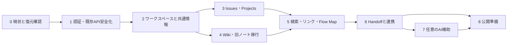

# 開発工程と依存関係

本工程は推奨順序であり、今回の実行範囲は調査・設計・AGENTS.md作成まで。アプリ実装、SQL適用、データ移行、秘密情報変更、デプロイはしていない。

## 1. 推奨順序と完了条件

| 工程 | 実施内容 | 依存 | 完了条件 |
| --- | --- | --- | --- |
| 0. 現状確定 | 実DBの列/型/ポリシー/GRANT/適用履歴、旧データ件数と所有者、OAuth/Vercel設定を値を伏せて確認。隔離環境と復元可能なバックアップ準備 | なし | 本番との差異と所有者不明データが一覧化。復元方法確認 |
| 1. 安全な既存基盤 | notes認証必須化、ユーザー権限アクセス、002の型不整合補正案、特権/JSONフォールバック解消、エラーと入力検証、Gemini入口の保護 | 0 | 別ユーザー/未認証の閲覧・変更・削除を拒否。正規ユーザーの既存CRUD継続 |
| 2. WS・共通情報 | WS/所属/招待/役割、resources、RLS、共通ナビ、認証callback。最小の監査基盤 | 1 | 個人/複数WS、越境拒否、脱退、owner移譲の検証に合格 |
| 3. Issues・Projects | 永続CRUD、状態、担当、期限、プロジェクト一覧・所属、競合制御 | 2 | AI未設定で登録→担当→完了まで動作。関連先越境拒否 |
| 4. Wiki・旧ノート移行 | 原文保存、版履歴、下書き/公開、通常検索、移行対応表とプレビュー | 2（統合は3） | 旧ノートを失わず閲覧可能。再実行で重複せず、移行後件数・本文照合が一致 |
| 5. 情報リンク・Flow Map | 関連付け、検索、グラフ＋一覧、由来表示、上限・ページング | 3,4 | 日本語の過去課題/資料をAIなしで検索し、関連をたどれる。不可視情報を返さない |
| 6. Handoff・連携 | 下書き、資料選択、確認項目、送信版、受領、改訂、監査。Flowから追加 | 5 | 作成→送信→確認→受領。改訂競合/二重受領/脱退を検証。旧版不変 |
| 7. AI補助 | 現行Gemini API、限定コンテキスト、要約/検索/関連/引き継ぎ案、引用・採用確認、共有レート制限 | 5,6 | AI障害でも基本機能継続。権限外入力なし、偽参照ID拒否、勝手に業務更新しない |
| 8. 公開準備 | 非技術者の操作確認、モバイル/アクセシビリティ、性能、運用手順、README刷新、段階リリース | 1〜7（AIなしの公開は6までで可） | 権限・移行・主要E2E合格、切戻し手順確認、未解決リスク明示 |

工程3と4は共通基盤が確定すれば独立して進められる。Flowの前に検索と明示リンクを完成させる。Handoffはまずフォーム・版固定・受領を成立させ、その後にMapとの操作導線を統合する。AIは通常機能のデータと権限を再利用し、先行実装しない。

## 2. 既存データを残す移行計画

1. DBと`data/notes.json`を別々の移行元として扱い、件数、ID重複、owner、日時形式を確認する。調査資料に本文や秘密を載せない。
2. ownerが有効なauth.users UUIDに対応するか確認する。旧ownerの型や不正値をその場で強制変換しない。所有者不明は隔離し、本人/管理者確認を待つ。
3. ユーザーごとの個人WSなど、移行先を明示した対応表を作る。既存個人データを自動で共有WSへ公開しない。
4. resources/wiki_pages/wiki_revisions/legacy_note_importsへコピーする。旧notesを更新・削除せず、元ID・入力・日時・所有者を保存/対応付けする。曖昧なローカル日時は推測で確定せず元文字列と確認状態を保持する。
5. 1ノートを1トランザクションで移行し、UNIQUEとハッシュで再実行を安全にする。同じIDで本文が変わった場合はスキップせず差異として報告する。件数は正確なcountとページングで確認する。
6. 原文ハッシュ・件数・WS/所有者対応・権限・代表的な表示を照合してから読み取り先を切り替える。切替中の旧書込みは短い保守時間で停止し、差分を取り込む。無計画な二重書込みはしない。
7. 旧画面は新しいコピーを案内し、元データは読み取り専用で保持。失敗時は新経路を停止し、安全化した旧画面へ戻す。切替後の新規データは保持し、必要な差分を抽出してから戻す。

バックアップはSupabaseの利用可能な方式か非公開領域へのエクスポートを選び、復元を隔離環境で確認する。公開スキーマにRLSなしのデータコピーを作らない。所有者一括変更、NOT NULL化、既存列削除は、検証と明示した適用判断なしに実行しない。

## 3. テストの重点

| 対象 | 主なシナリオ |
| --- | --- |
| 認証/RLS | 未認証、無効/期限切れtoken、別WS、同じユーザーの複数WS、脱退、role偽装、viewer書込み、最後のowner |
| データ整合性 | resource kindとサブタイプ一致、関連両端/担当者/プロジェクトの越境、自己参照/循環、版競合、アーカイブ後の履歴 |
| Wiki | 下書き秘匿、公開と版保存、同時編集、原文維持、安全なMarkdown描画 |
| Flow | 日本語部分一致、絞込・ページング、ノード/エッジ上限、不可視タイトル/件数の漏れなし、一覧のみでも操作可能 |
| Handoff | 指名本人だけの受領、必須チェック、旧版受領拒否、二重送信、改訂と受領の同時実行、受取人脱退、資料更新後のsnapshot不変 |
| AI | キーなし、タイムアウト、429、不正出力、権限外参照、本文内の指示、採用時の権限変更、インスタンスをまたぐ制限 |
| 移行 | 0件、大量件数、null/不正owner、元ID重複、不明日時、途中失敗・再開、再実行、切替直前更新、復元 |
| UI/E2E | 新規WS→課題→資料→関連→引き継ぎ→受領をAIなしで完了、保存失敗時の入力保持、モバイル、キーボード |

DBテストは隔離環境に作った複数ユーザー・WSで実施し、本番ユーザーをテスト作成しない。RLS検証はservice_roleで代用せず実ユーザー権限でも確認する。通常lint/buildに加え、認証・状態遷移・移行を統合テストで保証する。単に実装を写すテストは増やさない。

## 4. 実装開始前に確定する事項

- 実環境での002適用状態と既存ノート所有者。最初の移行バッチの対象と件数。
- 「WS全員に送信済みHandoffを公開」「memberは共有情報を編集できる」という初期権限モデルの利用現場への適合。
- 日本語検索のデータ量と速度、利用可能なPostgreSQL拡張。初期性能目標は計測後に確定する。
- 利用可能なGeminiモデル・利用条件と送信できる情報、AIのWS単位の上限。
- 招待リンクの有効期間、監査・送信版・バックアップの保存期間。

これらの未確定事項があっても、設計にあるAIなしの基本フローと権限境界を起点に小さく進められる。非公開プロジェクト、複数受取人、添付、外部通知、意味検索は別の設計変更として扱う。

## 5. 今回の成果物と確認

- `01-investigation.md`: 現状9項目、再利用方針、セキュリティと未確認事項。
- `02-design.md`: 画面・ディレクトリ・DB/関連・権限・Flow/Handoff設計。
- 本資料: 工程、依存、非破壊移行、検証方針。
- ルート`AGENTS.md`: 今後のCodex開発で守る共通ルール。

今回の変更は上記Markdownの追加のみ。文書参照・git差分を確認し、アプリコード/SQL/設定/データは変更しない。lint/build、SQL適用、外部API疎通、DB接続は今回未実施。
